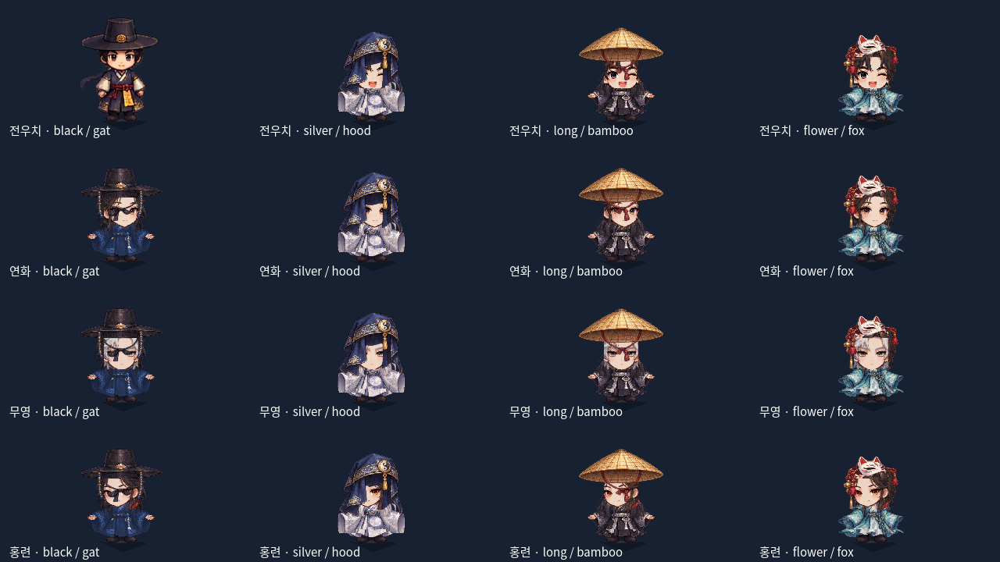
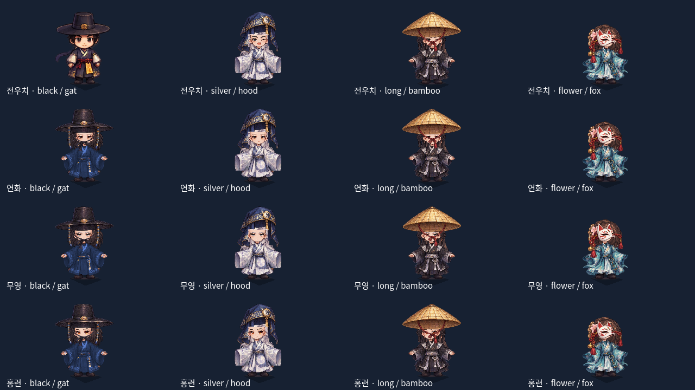

# 외형 조합 수정 — 2.0.3 / versionCode 14

기존 V2.0 게임에 적용하는 꾸미기 수정 빌드입니다. 패키지, 서명, 저장 파일, 아이템 ID 및 획득 조건은 유지합니다. 작업 전 상태는 `backup/dosa-2.0.2-appearance` (`a604d9d`)에 보존했습니다.

## 실제 원인과 수정

- 기존 `layers.png` 얼굴 이미지 자체에 원래 헤어·꽃 장식이 포함되어 있었습니다. 얼굴의 직사각형 일부를 잘라도 헤어가 남아 다른 헤어와 중복되었습니다. 원본 의상·모자·장신구는 보존하고, 머리 없는 얼굴 4개 / 뒷머리 6개 / 앞머리 6개를 분리한 `head_parts.png`를 추가했습니다.
- 긴 머리가 의상 뒤가 아닌 위에 그려졌습니다. 실제 Actor의 자식 순서를 그림자 → 뒷머리/등 장식 → 기존 몸체 → 의상/얼굴/앞머리/모자로 분리했습니다. 전역 Z 순서를 바꾸지 않아 월드의 캐릭터 Y 정렬을 유지합니다.
- 모자 착용 때 앞머리 전체를 줄였고 모든 캐릭터에 동일한 좌표를 적용했습니다. `compatibility.gd`에서 캐릭터별 얼굴·머리·모자 보정, 의상별 목선, 모자별 착용 높이·가림 규칙을 관리합니다. 모자 종류가 바뀌어도 헤어의 원래 크기·등록 좌표는 유지하고 가려지는 부분을 셰이더로 처리합니다. 두건은 얼굴 노출 영역, 여우 가면은 얼굴 착용 규칙을 사용합니다. 후면에서 얼굴/가면과 앞쪽 턱끈을 표시하지 않습니다.
- 기본 캐릭터의 머리 분할선이 원본 셔츠 일부까지 포함했고, 의상 소매는 어깨가 아닌 그림 좌상단을 중심으로 회전했습니다. 분할선을 목 위로 올리고 소매 회전축을 어깨로 옮겼습니다. 원래 전우치 기본 차림은 기존 원본 스프라이트를 계속 사용합니다.
- 캐릭터 선택 이벤트가 헤어·의상·모자·색상까지 기본값으로 덮어썼습니다. 캐릭터 ID만 변경하도록 수정했습니다. 미리보기는 임시 draft, 저장은 기존 Profile.equip, 취소는 draft 폐기를 사용합니다.

## 구현 범위와 남은 점

모든 캐릭터에 6개 헤어, 7개 모자(없음 포함), 8개 의상을 조합할 수 있습니다. 장신구의 등/허리 부착 순서를 분리했습니다. 기존 목록에 별도 ‘붉은 머리’ ID는 없으므로 새 해금 아이템을 임의로 추가하지 않았습니다. 홍련 얼굴에 원래 붙어 있던 헤어/붉은 장식을 얼굴 데이터에서 제거해 선택한 헤어가 우선합니다.

렌더러는 정지·방향·걷기·점프·착지·공격 상태를 외형 데이터와 분리합니다. 점프할 때 뒷머리·몸체·앞쪽 외형의 높이만 함께 바뀌며 그림자는 지면에 남습니다. 광장, 모험, 수련장, 멀티플레이는 기존 공통 WooActor를 사용합니다. 네트워크 외형 프로토콜과 서버 역할/장착 규칙은 변경하지 않았습니다.

장식 에셋은 기존 정면 아트를 재사용합니다. 모든 의상에 새 8방향 수작업 원화를 제작한 것은 아니며, 측면은 기존 방식처럼 좌우 반전과 공통 관절 동작을 사용합니다. 픽셀 단위의 모든 조합을 사람이 미술 검수한 것은 아닙니다.

## 비교 화면

동일한 카메라·배율·16개 조합을 실제 게임 렌더러로 출력했습니다. 게임 배경에 콘셉트 이미지를 붙인 결과가 아닙니다.

| 수정 전 | 수정 후 |
|---|---|
|  |  |

[모자 없는 헤어](appearance-2.0.3/uncovered.png) · [방향·걷기·점프·공격](appearance-2.0.3/poses.png) · [실제 꾸미기 화면](appearance-2.0.3/game.png)

## 검증

`tests/appearance_combinations.gd`는 4×6×7×8 = 1,344개 조합과 각 8방향/점프/공격 상태, 장신구·색상, 공통 기준점, 얼굴/헤어 분리, 잠금 상태, 저장/취소, 광장/모험을 검사합니다. 별도 프로세스 쓰기/읽기는 기존 version1 외형·알 수 없는 보유 아이템·별도 진행 파일이 유지되는지 검사합니다.

실제 그래픽 드라이버로 1,344개 Actor를 11페이지에 걸쳐 렌더링했습니다. 재현 명령:

```sh
godot --path . --audio-driver Dummy --script res://tests/appearance_render.gd -- --phase=gallery
godot --path . --audio-driver Dummy --script res://tests/appearance_render.gd -- --phase=after
bash tools/checkpoint.sh
```

검증 실행 결과·GitHub 링크·APK 체크섬은 최종 검증 기록에 첨부합니다. Galaxy 실기기, 공개 서버에 연결한 Android 기기 간 외형 확인은 이 Cloud 환경에서 수행하지 않았습니다.

## 휴대폰 확인

기존 앱을 삭제하지 말고 업데이트 설치한 후 **이어하기**를 사용하세요. 도사 꾸미기 → 연화/은백색/두건 → 방향·걷기·점프·공격 → 저장 → 광장/그림 속 모험 확인 → 앱 종료·재실행 → 이어하기로 점검합니다. 미보유 캐릭터/의상은 미리보기만 가능하고 기존 조건을 충족해야 저장됩니다.
