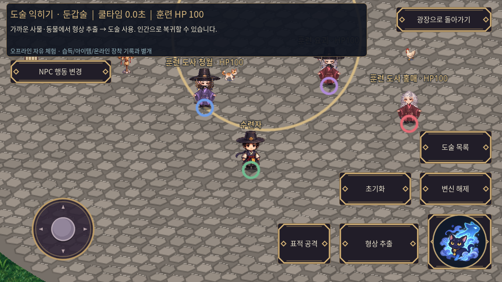

# 도술 익히기 — 오프라인 수련장 / 2.0.4

기존 V2.0에 오프라인 수련장을 추가하는 빌드입니다. 버전 2.0.4 / Android versionCode 15. 기존 패키지·서명·저장 구조·캐릭터·모험·온라인 습득/장착 검증을 유지합니다. 변경 전 코드는 `backup/dosa-2.0.3-before-dojo`에 보존합니다.

## 휴대폰에서 입장

1. 기존 앱을 삭제하지 말고 업데이트 설치 → **이어하기**.
2. 광장 동쪽, 기존 수련소 아래쪽의 푸른 입구와 **도술 익히기** 현판을 찾습니다. 문 앞에서 **도술 익히기 입장**을 누릅니다. 입구 위치는 월드 (2450, 685)입니다. 기존 건물과 그림 장터는 유지합니다.
3. 더 빠른 경로: **메뉴 → 도술 → 체험하기**. 도감의 모든 체험 버튼은 동일한 수련장으로 연결됩니다.
4. 수련장의 **도술 목록**에서 선택합니다. 습득/유료/VIP 제한 없이 체험하지만 실제 도술을 획득한 것으로 기록하지 않습니다.
5. **광장으로 돌아가기** 또는 Android 뒤로가기로 복귀합니다. 모험 중 도감에서 입장하면 원래 모험으로 돌아갑니다.

온라인 서버 주소나 회원가입이 필요 없습니다. 실제 온라인 습득·경기 검증을 완료했다는 의미는 아닙니다.

## 실제 구현된 도술

현재 등록된 공통 8개 + 요괴 5개 + 모험 부적술 = **14개**를 체험합니다. 기존 `jar`는 `transform`(둔갑술)의 별칭으로 처리하며 중복 도술로 세지 않습니다. 미등록 미래 도술을 구현된 것으로 표시하지 않습니다.

| 도술 | 실제 기능 / 시험 방법 |
|---|---|
| 둔갑술 | 사물/동물 가까이서 **형상 추출** → 잠시 정지해 완료 → 도술 사용. 항아리·상자·바구니·등불·짚단·문짝·허수아비·고양이·강아지·닭과 동일한 기존 에셋으로 변신합니다. 동물은 이동 애니메이션을 사용합니다. |
| 축지법 | 바라보는 방향으로 110 월드 단위 이동. 공유된 3px 이하 이동/충돌 검사로 벽을 통과하지 않습니다. |
| 분신술 | 같은 외형·색상의 분신을 생성하고 이동시킵니다. 장애물 충돌을 검사하며 8초 후 제거됩니다. 훈련 NPC가 분신에 유인됩니다. |
| 추적부 | NPC가 실제 이동하며 남긴 최근 발자국을 표시합니다. |
| 호신부 | 훈련 요괴의 공격을 실제로 방어하고 소모되며 보호 시간이 생깁니다. 방어하지 못하면 훈련 HP가 감소합니다. |
| 연막술 | 연막 안에서 먼 NPC를 가리고, NPC도 플레이어를 놓칩니다. 효과 종료 시 시야가 복원됩니다. |
| 천면술 | 기존 `mask`의 얼굴/신원 가림을 재사용합니다. 이름과 식별 표시를 숨기고 훈련 NPC의 식별 거리를 줄입니다. 플레이어 외형 복제는 별도 타인 둔갑입니다. |
| 해봉술 | 감옥의 도사 옆에서 도술 사용 → 상호작용. 실제 구출 채널을 1.2초로 단축하고 구출 후 보호 시간을 적용합니다. |
| 그림자 포획 | 가까운 훈련 도사를 실제로 포획해 감옥으로 이동시킵니다. |
| 어둠의 장막 | 공유 시야 판정으로 시야를 차단하고 가까운 봉인 표적을 일시 방해합니다. |
| 가짜 혼불 | 수명이 있는 혼불을 생성해 훈련 NPC를 유인합니다. |
| 그림자 이동 | 150 월드 단위 이동. 축지법과 같은 충돌 검사로 벽을 통과하지 않습니다. |
| 타인 둔갑 | 가까운 훈련 도사의 캐릭터·헤어·의상·모자·장신구·색상을 복제합니다. 실제 ID는 유지하며, 해제/만료 시 원래 외형으로 돌아옵니다. |
| 부적술 | 모험과 공유하는 부채꼴 판정·사거리·32 피해·1.4초 봉인·쿨타임·공격 연출을 사용해 훈련 NPC/표적을 타격합니다. 실제 도력은 소모하지 않습니다. |

지속 시간과 쿨타임은 기존 온라인 카탈로그/설정 및 모험 action_config를 사용합니다. 밸런스는 기존과 같은 임시 수치입니다. 형상은 기본 3개까지 기억하며 **초기화**하면 모두 비워집니다. 형상 추출/구출 도중 이동하면 채널이 취소됩니다.

## 맵과 NPC

실제 이동 가능 맵은 1280×960 월드 단위입니다. 기존 광장과 같은 픽셀 아트 한옥, 나무, 등불, 마당, 담장, 충돌 벽을 배치했습니다. 바닥은 기존 잔디/불규칙 돌길 렌더러로 한 번 베이크하고, 건물·사물·동물·NPC·충돌은 독립적으로 처리합니다. 콘셉트 이미지 한 장을 맵 대신 붙이지 않았습니다.

**NPC 행동 변경** 버튼: 산책 → 대기 → 추적 → 공격 → 방어. 공격 모드의 요괴는 준비 동작 후 공격합니다. 호신부를 시험하려면 이 모드를 선택하고 가까이 접근하세요. 훈련 체력이 0이 되면 자동 회복하며 실제 HP/아이템을 소비하지 않습니다. **표적 공격**으로 NPC 피해·경직·넉백을 시험할 수 있습니다. 방어 모드에서는 NPC도 호신부로 공격을 막습니다. NPC 체력은 소진되면 자동 회복하고 실제 보상을 지급하지 않습니다.

[광장 입구](practice-2.0.4/entrance.png) · [도술 목록](practice-2.0.4/list.png) · [도감](practice-2.0.4/codex.png) · [고양이 둔갑](practice-2.0.4/cat.png) · [분신](practice-2.0.4/clone.png) · [타인 둔갑](practice-2.0.4/mimic.png)

## 실제 게임과 공유하는 코드

- `SealRules.command/cast/tick/view`: 도술 조건, 지속/쿨타임, 채널, 추출/변신, 포획/구출, 복제/색상/ID, 흔적, 연막 시야 판정.
- `SealArena`: 동일한 지형/사물 속성·충돌·거리/시선 검사. 이동 검사에서 막힌 구간을 건너뛰던 오류를 현재 위치 기준의 작은 스텝으로 수정했습니다. 온라인의 분신도 동일한 이동/충돌 로직을 사용합니다.
- `WooActionConfig`, `WooCombatEffects`, `WooActor`, `SealEnvironmentAsset`: 모험의 실제 전투 판정/수치/효과, 동일한 캐릭터/꾸미기/사물·동물 렌더러.
- `WooPracticeRules`는 독립된 로컬 인스턴스이며 승패 판정만 사용하지 않습니다. 로컬 계정/장착 예외는 이 세션에만 주입합니다. 서버나 실제 프로필에 체험 권한을 추가하지 않습니다.
- 도감과 수련장 메뉴는 같은 PracticeCatalog를 사용합니다. 기존 모험의 3슬롯과 실제 장착 가능 여부는 유지합니다.

## 저장 보호와 복귀

원래 플레이어·맵·카메라 노드를 이동시키지 않고 숨김/정지한 뒤 별도 임시 플레이어를 만듭니다. 정상 복귀 시 원래 위치/방향, 카메라 위치·확대율·회전, 변신/외형을 그대로 사용합니다. 2D이므로 별도 Z 좌표는 없고 점프 높이는 원래 Actor 상태에 남습니다.

수련 중에는 일반 자동 저장 경로를 실행하지 않습니다. 실제 RPG 데이터, 소지품, 습득 기록, 온라인 계정/승리/권한 파일과 옷장 데이터는 수련 상태와 분리됩니다. 앱을 닫아도 체험 기록을 실전 데이터로 저장하지 않습니다. 백그라운드 진입 시 입력을 해제하고 로컬 시계를 멈춥니다.

새 입구가 예전 저장 위치를 차지할 수 있으므로 맵 revision 3→4 이전을 사용합니다. 해당 경우에만 기존 진행 기록을 유지하면서 가장 가까운 안전 위치로 옮기고 원래 좌표를 보관합니다. 보통의 수련장 입장/복귀는 재배치하지 않습니다.

## 검증 범위

도술·맵·NPC·저장 보호·배경 복귀·실제 복제 렌더러 검사 및 네 화면 크기(1280×720, 2400×1080, 2340×1080, 960×540)의 네이티브 터치 이벤트 검사를 자동화했습니다. 터치 시험은 Linux Godot에 Android 형식 이벤트를 주입하는 방식이며 Galaxy 실기기 시험은 아닙니다.

최종 테스트 결과·소스 커밋·APK 체크섬과 Actions 다운로드는 최종 검증 기록에 덧붙입니다. 공개 멀티 서버/Android 기기 간 시험을 오프라인 수련 성공으로 대체하여 주장하지 않습니다.
